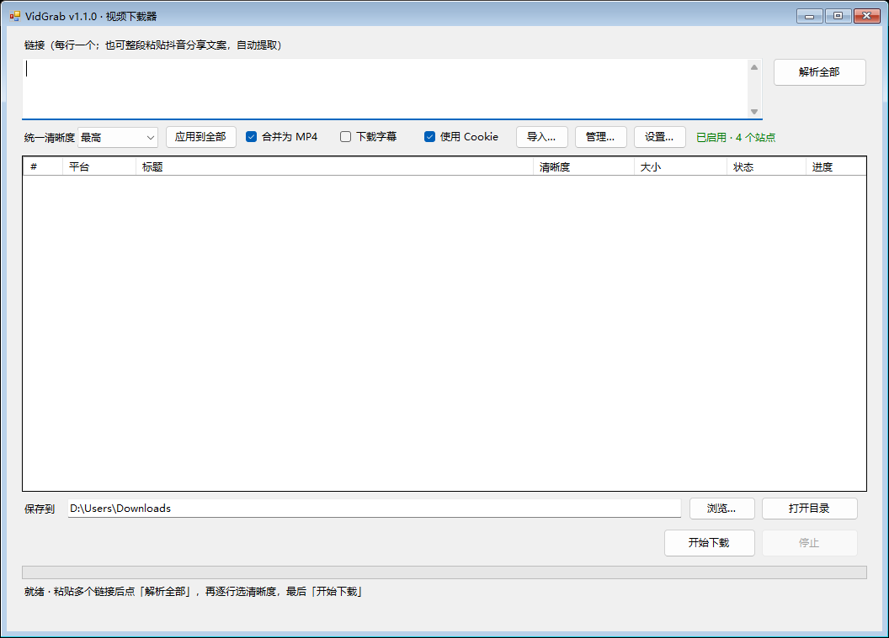

# VidGrab

**A single-file, batch video downloader for Windows** — YouTube, TikTok, Douyin, X (Twitter) and Instagram.

[中文说明](README.md) · [Releases](https://github.com/crinsgod/VidGrab/releases) · [Issues](https://github.com/crinsgod/VidGrab/issues)

[](https://github.com/crinsgod/VidGrab/releases)
[](LICENSE)
[](#)



## What it is

VidGrab wraps yt-dlp in a small WinForms UI and adds native paths for sites yt-dlp handles poorly:

- **Single executable** — yt-dlp and ffmpeg are embedded and extracted on first run.
- **Batch queue** — paste many links, pick a quality per row, download them in order.
- **No per-link dialogs** — one message box never appears for each item; use "apply to all" or adjust rows inline.
- **Multi-threaded direct downloads** — 1 MB range chunks, resumable, retried.
- **Cookie manager** — merge per-site exports into one file, check login state, remove sites.

## Features

| Feature | Notes |
|---|---|
| Batch parse | One link per line or a whole share message; URLs are extracted and deduplicated |
| Quality picker | Every row lists the formats that video actually offers (resolution, container, codec, size) |
| Apply to all | Matches the closest available quality per row |
| Sequential queue | One download at a time; stop at any moment |
| MP4 merge | Separate audio/video streams are merged with the bundled ffmpeg |
| Collision-safe names | Format id is part of the filename, so a different quality never overwrites or gets skipped |
| Cookies | Netscape format, merged across sites, with online login-state checks |
| Subtitles | Optional download and embed (YouTube and compatible sites) |
| Proxy | HTTP or SOCKS5, applied to both parsing and downloading |
| Multi-thread | 1 MB chunks, 1–16 threads (default 4), resumable via `.part` files |

## Supported platforms

| Platform | How it is parsed | Cookies |
|---|---|---|
| YouTube | yt-dlp | Optional (age-restricted) |
| TikTok | yt-dlp | Optional |
| Douyin | public parse endpoint + official no-watermark play URL | Not needed |
| X (Twitter) | public API, direct mp4 variants | Not needed |
| Instagram | yt-dlp (DASH) | Needed for private posts |
| Others | any of yt-dlp's 1000+ sites | Depends on the site |

## Download

Grab the latest `VidGrab.exe` from [Releases](https://github.com/crinsgod/VidGrab/releases).

1. Run it. The build is unsigned, so SmartScreen may warn you — choose "More info → Run anyway".
2. On first launch, yt-dlp and ffmpeg are extracted to `%LOCALAPPDATA%\VidGrab\bin`.
3. Paste links → **Parse all** → choose quality → **Start download**.

Verify the download:

```powershell
Get-FileHash .\VidGrab.exe -Algorithm SHA256
```

## Usage

### Batch download

1. Paste one link per line (Douyin share messages are fine).
2. Click **Parse all**; each row gets its own quality dropdown.
3. Adjust rows, or set a global quality and click **Apply to all**.
4. Click **Start download** — tasks run in order.

Clicking **Start download** with nothing parsed first parses everything and waits for you to confirm quality.

### Cookies

1. Install the **Get cookies.txt LOCALLY** browser extension.
2. Log in to the target site, open the page, export as Netscape `cookies.txt`.
3. Click **Import…** — imports are merged, never overwritten.
4. Repeat for other sites; use **Manage…** to inspect login state, delete a site, or clear everything.

### Settings

| Option | Meaning |
|---|---|
| Threads | Chunk concurrency for direct downloads (1–16, default 4) |
| Proxy | `http://127.0.0.1:7890` or `socks5://…`, leave empty to follow the system |
| Download subtitles | Downloads and embeds `zh-Hans/zh-Hant/zh/en` when available |
| Merge to MP4 | Merge separate streams with ffmpeg |

## Build from source

Requires Windows 10/11 and .NET Framework 4.8 (its `csc.exe` ships with Windows).

```powershell
git clone https://github.com/crinsgod/VidGrab.git
cd VidGrab
powershell -ExecutionPolicy Bypass -File .\build.ps1
```

The script downloads yt-dlp and ffmpeg, compresses them into the executable, and writes `dist\VidGrab.exe` (about 80 MB).

## Project layout

```text
src/                  # WinForms app (.NET Framework 4.8)
  MainForm.cs         # UI and task queue
  YtDlp.cs            # yt-dlp probe/download wrapper
  DirectDownloader.cs # chunked, resumable, retried HTTP downloads
  Douyin.cs           # Douyin parsing and direct URL
  XTwitter.cs         # X public API parsing
  CookieStore*.cs     # merged cookie store
  CookieChecker.cs    # login-state checks
docs/images/          # screenshots
build.ps1             # one-command build
```

## Third-party components

- [yt-dlp](https://github.com/yt-dlp/yt-dlp) — Unlicense
- [FFmpeg](https://ffmpeg.org/) (BtbN GPL build) — GPLv3, see [THIRD_PARTY_NOTICES.md](THIRD_PARTY_NOTICES.md)

## Disclaimer

For personal study and backup only. Respect each platform's terms of service and local law. You are responsible for anything you download or redistribute.

## License

[MIT](LICENSE)
